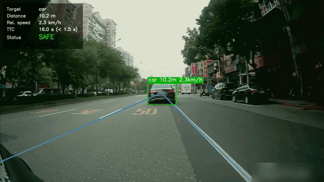
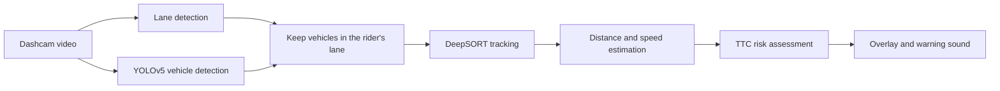

# Motorcycle Collision Warning System

A forward collision warning system for motorcycles that runs on dashcam video. It detects
the rider's lane, tracks vehicles ahead, estimates their distance and relative speed, and
plays a warning sound when the time-to-collision (TTC) becomes too short.



*License plates and the dashcam's GPS overlay are blurred.*

## How It Works



1. **Lane detection**: Canny edges, a road-area color mask, and the Hough transform find the
   left and right lane lines in each frame.
2. **Vehicle detection**: a COCO-pretrained YOLOv5s model detects bicycles, cars,
   motorcycles, buses, and trucks.
3. **Lane filtering**: a vehicle is kept only if the bottom-center of its bounding box lies
   inside the rider's lane.
4. **Tracking**: DeepSORT assigns a consistent ID to each vehicle across frames.
5. **Distance and speed**:
   - Distance is estimated from the bounding box height:
     `distance = real vehicle height × focal length / box height`.
   - Relative speed is estimated every 10 frames from how far a tracked vehicle moves,
     using its real width to convert pixels to meters.
6. **Risk assessment**: `TTC = distance / relative speed`. A vehicle is high risk when
   TTC ≤ 1.5 s (half of an assumed 3 s reaction-and-braking time).
7. **Output**: each vehicle is labeled with its class, distance, and speed (green when safe,
   red when high risk). An info panel shows the most critical vehicle, and a warning sound
   is added at each high-risk moment.

## Project Structure

```
motorcycle-collision-warning/
├── main.py                  # Command-line entry point
├── demo.ipynb               # Runs the pipeline and shows the results
├── config.yaml              # All tunable parameters
├── src/                     # Project code
│   ├── pipeline.py          # Connects all steps
│   ├── lane_detection.py    # Lane detection
│   ├── lane_filter.py       # Keeps vehicles in the rider's lane
│   ├── distance.py          # Monocular distance estimation
│   ├── speed.py             # Relative speed estimation
│   ├── risk.py              # Track matching, TTC, and risk level
│   ├── overlay.py           # Labels, lane lines, and info panel
│   ├── audio.py             # Warning sounds and video export
│   └── config.py            # Loads config.yaml
├── third_party/             # YOLOv5 and DeepSORT (see third_party/README.md)
├── assets/warning.mp3       # Warning sound
├── videos/                  # Input videos (not included)
├── weights/                 # Model weights (not included)
└── outputs/                 # Results, one folder per video (not included)
```

## Getting Started

### 1. Install dependencies

Python 3.9 or later is recommended.

```bash
python3 -m venv .venv
source .venv/bin/activate
pip install -r requirements.txt
```

### 2. Add model weights

Model weights are not included in this repository.

| File | Source | Location |
|---|---|---|
| `yolov5s.pt` | [YOLOv5 v5.0 release](https://github.com/ultralytics/yolov5/releases/tag/v5.0) | `weights/yolov5s.pt` |
| `ckpt.t7` | [deep_sort_pytorch](https://github.com/ZQPei/deep_sort_pytorch) | `third_party/deep_sort/deep_sort/deep/checkpoint/ckpt.t7` |

The detection code is based on YOLOv5 v5.0, so weights from that release are required.

### 3. Add a video

Put a forward-facing dashcam video in `videos/`, for example `videos/CAR.mp4`.
The dashcam videos used in this project are not shared to protect privacy.

## Usage

```bash
python main.py --source videos/CAR.mp4
```

| Option | Description |
|---|---|
| `--source` | Input video |
| `--config` | Config file (default: `config.yaml`) |
| `--device` | `''` for auto, `cpu`, or a CUDA index such as `0` |
| `--skip-lanes` | Reuse existing lane data instead of detecting lanes again |
| `--no-lane-video` | Do not save the lane detection video |
| `--no-audio` | Do not add warning sounds |

Results are saved to `outputs/<video name>/`:

| File | Content |
|---|---|
| `result.mp4` | Final video with labels, info panel, and warning sounds |
| `lanes.mp4` | Lane detection result |
| `lanes.csv` | Lane corner coordinates for every frame |
| `warnings.csv` | Frame and time of each warning |
| `tracks.csv` | Position of every tracked vehicle in every frame |
| `speeds.csv` | Estimated relative speed of each vehicle |

The same pipeline can also be run from `demo.ipynb`, which displays the warnings and the
frames where they occurred.

## Configuration

All parameters are in `config.yaml`. The most important ones:

| Parameter | Default | Description |
|---|---|---|
| `warning.reaction_time_s` | 3 | Assumed reaction-and-braking time (s) |
| `warning.ttc_ratio` | 0.5 | Warn when TTC ≤ reaction time × ratio |
| `warning.min_gap_s` | 0.65 | Minimum time between two warning sounds |
| `detection.display_conf` | 0.40 | Minimum confidence to evaluate a vehicle |
| `distance.vehicle_heights_inch` | — | Real vehicle heights used for distance estimation |
| `speed.vehicle_widths_m` | — | Real vehicle widths used for speed estimation |
| `speed.calibration` | 1.9 | Empirical speed correction factor |

## Limitations

- **Distance** assumes a fixed real-world height for each vehicle class and a fixed focal
  length, so it is an approximation rather than a measurement.
- **Speed estimates are noisy.** Speed comes from box movement over 10 frames, so small
  changes in the bounding box can change the estimate a lot (for example, from 3 km/h to
  40 km/h within half a second). Because the warning depends on speed, this also affects
  when warnings occur. The estimate also does not distinguish between a vehicle getting
  closer and one moving away.
- **Lane detection** relies on visible lane markings and straight lanes. It can fail on
  curves, at intersections, or when a vehicle very close ahead hides the markings. When it
  fails, a vehicle directly ahead may be treated as outside the lane and missed.
- **Detection** uses a COCO-pretrained YOLOv5s model without fine-tuning on motorcycle
  dashcam footage.
- **Evaluation** was done on a small number of daytime videos only.

## Future Work

- Smooth speed estimates over time, or compute TTC from the rate of change of distance
- Use the sign of the distance change so only approaching vehicles trigger warnings
- Replace the Hough-based lane detection with a learning-based lane detector
- Upgrade the detector to a newer YOLO version and compare the results
- Fine-tune the detector on motorcycle dashcam footage

## Project History

This system was developed as a senior capstone project at Soochow University, completed in
December 2024. The original version ran in Google Colab as a single notebook.

In 2026 the project was restructured to run locally:

- Split the notebook into separate modules with a single configuration file and a
  command-line entry point
- Aligned lane detection and vehicle detection frame by frame (both now read video with
  OpenCV)
- Matched each detection to its own track when estimating speed, so every vehicle uses its
  own speed and distance for the TTC calculation
- Added color-coded labels and an info panel showing distance, speed, TTC, and risk status
- Separated third-party code into `third_party/`

## Team

Senior Capstone Project, Soochow University
Advisor: Prof. Jia Rong Lee

- Chun Hsiag Lu
- Chih Fan Chen
- Yu Ting Chen
- Hao Zhe Yan

## Acknowledgments

- [Ultralytics YOLOv5](https://github.com/ultralytics/yolov5) for object detection (GPL-3.0)
- [deep_sort_pytorch](https://github.com/ZQPei/deep_sort_pytorch) for multi-object tracking (MIT)

See [third_party/README.md](third_party/README.md) for details.
